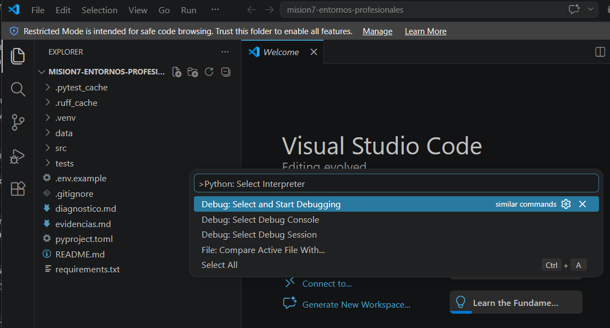
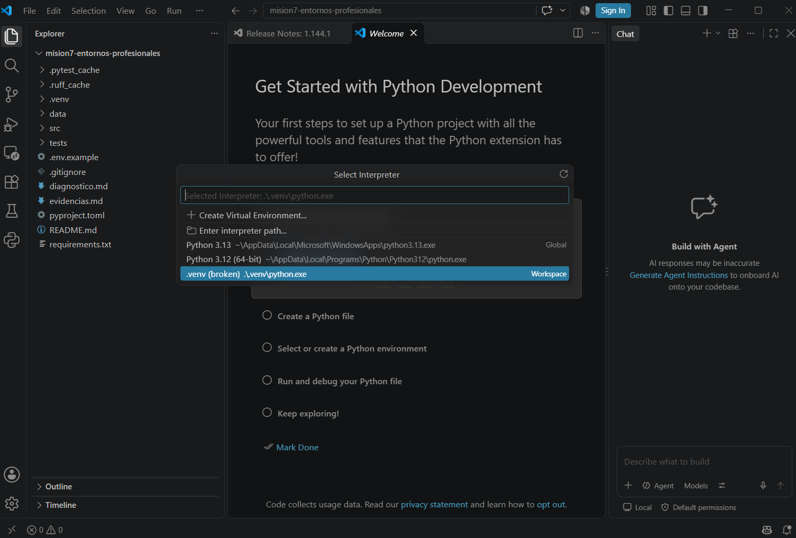
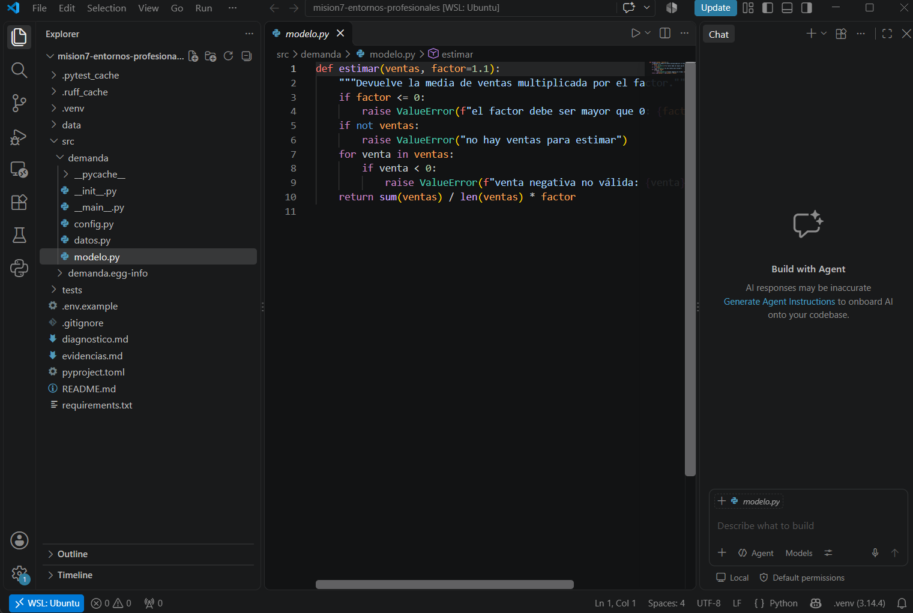
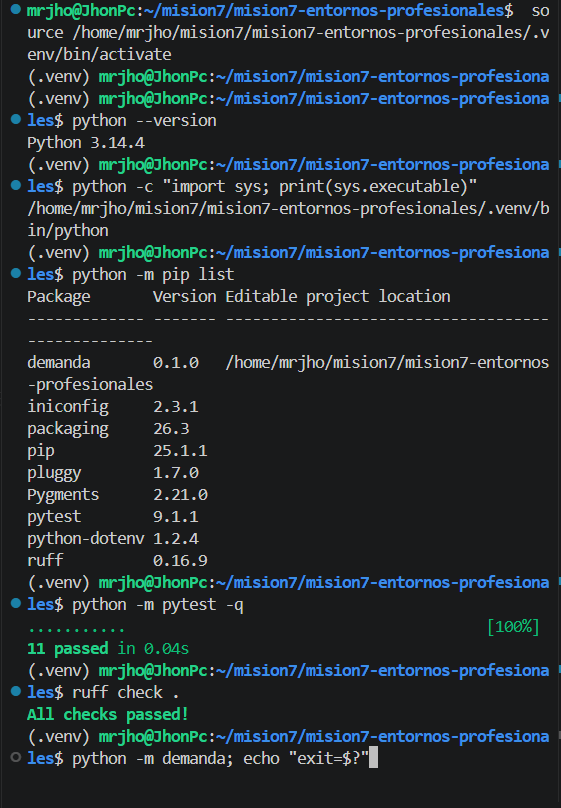
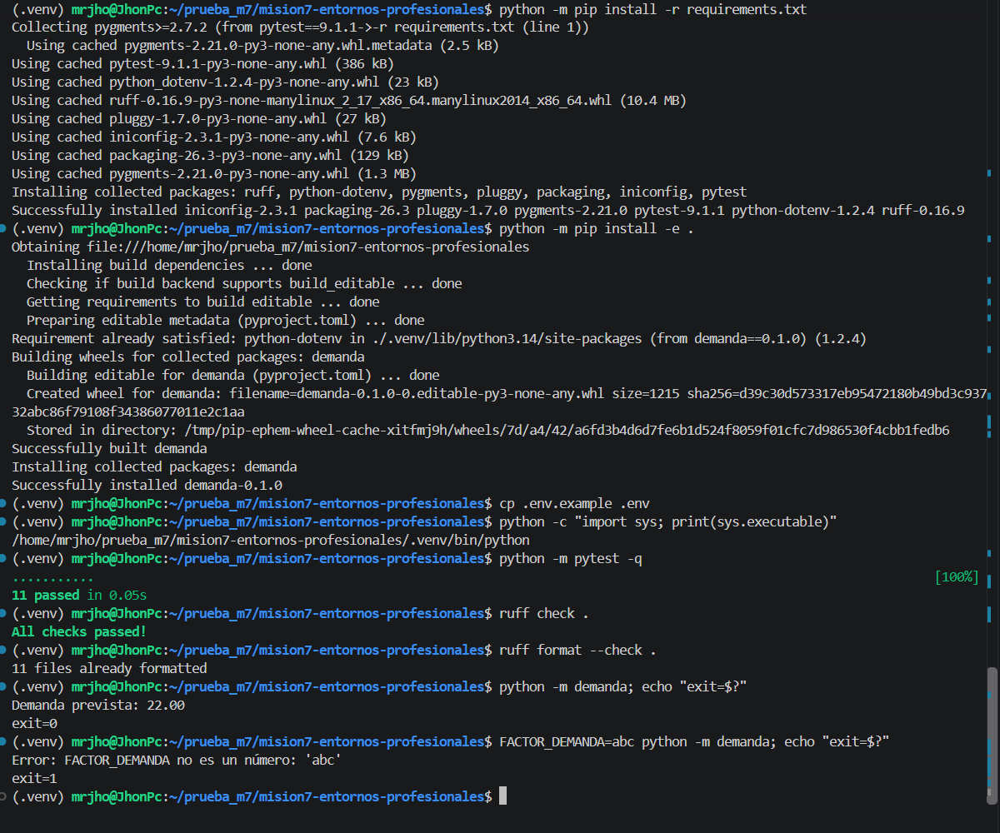
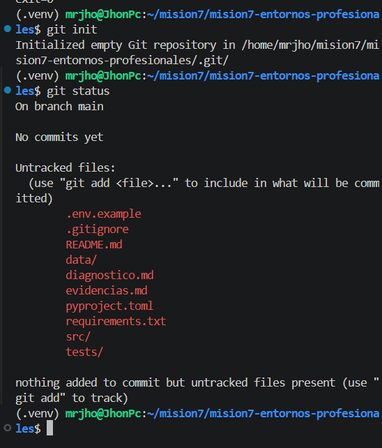
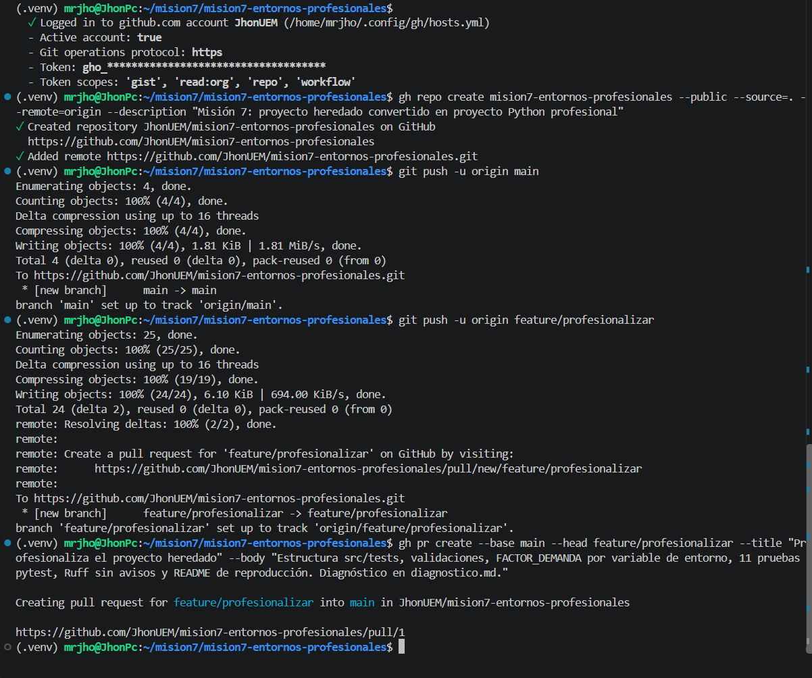
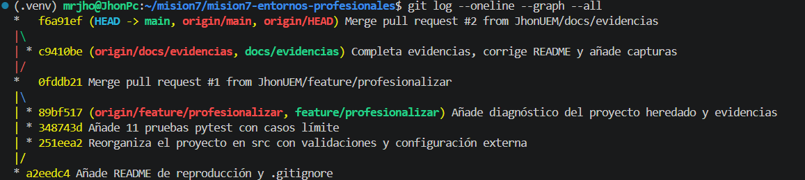

# Evidencias — Jhon Mario Sepúlveda Torres (trabajo individual)

Misión 7 · El proyecto heredado. Repositorio: https://github.com/JhonUEM/mision7-entornos-profesionales (PR #1 y PR #2 fusionados). El zip incluye la carpeta `.git`, así que el historial se puede comprobar sin conexión con `git log --oneline --graph --all`.

## 1. Diagnóstico
Reproduje 7 problemas del `app.py` heredado: ruta fija, `ZeroDivisionError` con CSV vacío, `ValueError` sin indicar la línea, negativos aceptados (-5.5), factor 1.1 escrito en el código, lógica y E/S mezcladas, y sin requirements/pruebas/README. El detalle está en `diagnostico.md`.

## 2. Entorno
- Python 3.14.4 en WSL (Ubuntu), entorno `.venv` en la carpeta del proyecto.
- Instalación: `python -m pip install -r requirements.txt` + `python -m pip install -e .`
- Versiones fijadas: pytest 9.1.1, python-dotenv 1.2.4, ruff 0.16.9. Las fijé porque son las que probé; con versiones libres, otro equipo podría instalar una más nueva y obtener resultados distintos.

Incidencias al configurar VS Code:

| Incidencia | Causa | Solución |
|---|---|---|
| No existía `Python: Select Interpreter` (captura 1) | Carpeta en *Restricted Mode*: extensiones desactivadas | Confiar en la carpeta (Manage → Trust) |
| El intérprete salía como `.venv (broken) .\.venv\python.exe` (captura 2) | Abrí la carpeta de WSL con VS Code de Windows (`\\wsl.localhost`); Windows busca `python.exe` y el venv de Linux tiene `bin/python` | Extensión WSL, `code .` desde Ubuntu e instalar la extensión Python en WSL |

*Captura 1. Modo restringido: la paleta solo ofrece comandos `Debug:`.*

*Captura 2. VS Code de Windows ve el venv de Linux como roto.*

*Captura 3. Ya resuelto: `WSL: Ubuntu` y `.venv (3.14.4)` en la barra inferior.*

*Captura 4. `sys.executable` apunta a `.venv/bin/python` (aislamiento), `pip list` coincide con `requirements.txt`, 11 pruebas y Ruff sin avisos.*

## 3. Calidad
- `ruff check .` → `All checks passed!` · `ruff format --check .` → `11 files already formatted`.
- Separé `datos.py` (leer y validar el CSV), `modelo.py` (cálculo, sin ficheros ni prints), `config.py` (factor) y `__main__.py` (argumentos, mensajes y código de salida). Así pruebo la lógica sin tocar ficheros.
- El factor se configura con `FACTOR_DEMANDA` (`.env` o terminal; la terminal tiene prioridad). Si no es un número o es ≤ 0, da error.

## 4. Pruebas
- 11 casos: normal, lista vacía, venta negativa, factor 0, CSV válido, valor no numérico (indica la línea), falta la columna, archivo inexistente, factor por defecto, factor desde el entorno y factor no numérico.
- `python -m pytest -q` → `11 passed in 0.04s`.

| Comprobación manual | Resultado | Exit |
|---|---|---|
| `python -m demanda` | Demanda prevista: 22.00 (igual que el original, 22.0) | 0 |
| ejecutar desde otra carpeta | Demanda prevista: 22.00 | 0 |
| `FACTOR_DEMANDA=1.25` | Demanda prevista: 25.00 | 0 |
| `FACTOR_DEMANDA=abc` | Error: FACTOR_DEMANDA no es un número: 'abc' | 1 |
| CSV vacío | Error: no hay ventas para estimar | 1 |
| CSV con -20 | Error: venta negativa no válida | 1 |

## 5. Transferencia
Trabajo solo, así que no hubo otra pareja. La sustituí por esto: después de fusionar el PR #1, cloné el repositorio desde GitHub en una carpeta nueva (`~/prueba_m7`), con el entorno anterior desactivado, y seguí solo el README.

- Resultado: instalación sin errores, `sys.executable` en el `.venv` nuevo, `11 passed`, `All checks passed!`, `22.00` con exit 0 y el caso `FACTOR_DEMANDA=abc` con exit 1 (captura 7).
- Incidencia: el README decía `8 files already formatted` y salieron 11. Causa: Ruff 0.16 también revisa los bloques de código de los `.md` (8 `.py` + 3 `.md`), y yo había medido antes de crear la documentación. Solución: el README ya no da una cifra fija; lo que importa es que no aparezca "Would reformat".

*Captura 7. Instalación desde cero en `~/prueba_m7`, siguiendo solo el README.*

## 6. Colaboración (Git y GitHub)
- `git status` antes del primer commit: no aparecen `.venv`, `__pycache__`, `.pytest_cache`, `.ruff_cache` ni `demanda.egg-info`, así que `.gitignore` funciona (captura 5).
- Flujo: commit base en `main` → rama `feature/profesionalizar` (3 commits) → push → PR #1 → merge. Después, rama `docs/evidencias` → PR #2 → merge. Fusioné con `--merge` para conservar los commits de cada rama.

*Captura 5. Solo aparecen los archivos del proyecto.*

*Captura 6. Creación del repositorio, push de las dos ramas y PR #1.*

*Captura 8. Historial final con los dos pull requests fusionados.*

## 7. Mejoras propuestas
- Añadir GitHub Actions que pase `ruff` y `pytest` en cada PR (es el tema de la Misión 8).
- Para un caso real, sustituir la media × factor por un modelo con tendencia o estacionalidad. Me gustaría aplicarlo a datos de vuelos, por ejemplo para estimar la demanda de plazas por ruta.

## 8. Uso de IA
Claude (Anthropic), noviembre de 2026: tutor y generación del código y la documentación. Revisé cada archivo, ejecuté yo las pruebas, los casos de error y la prueba de transferencia, y comprobé que la cifra coincide con el proyecto original (22.0).
